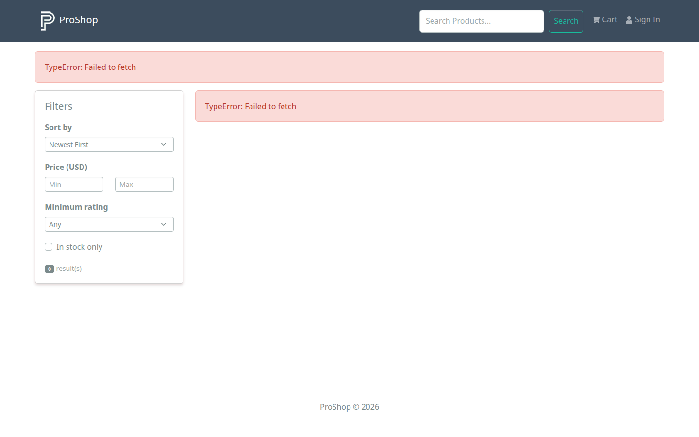
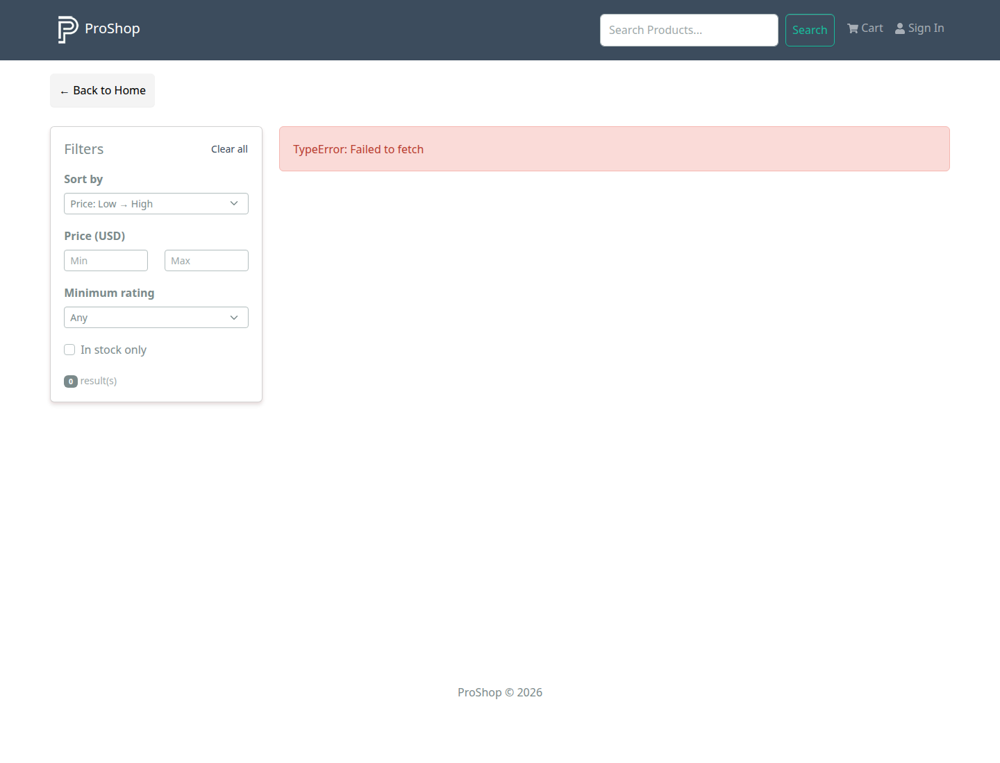
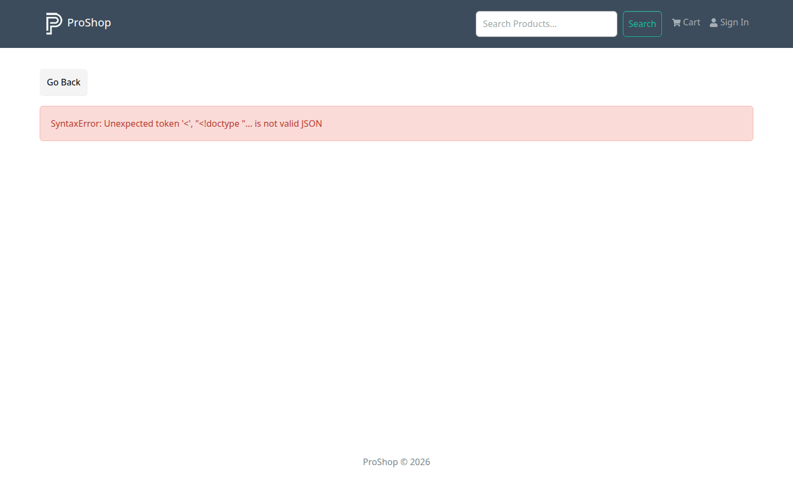
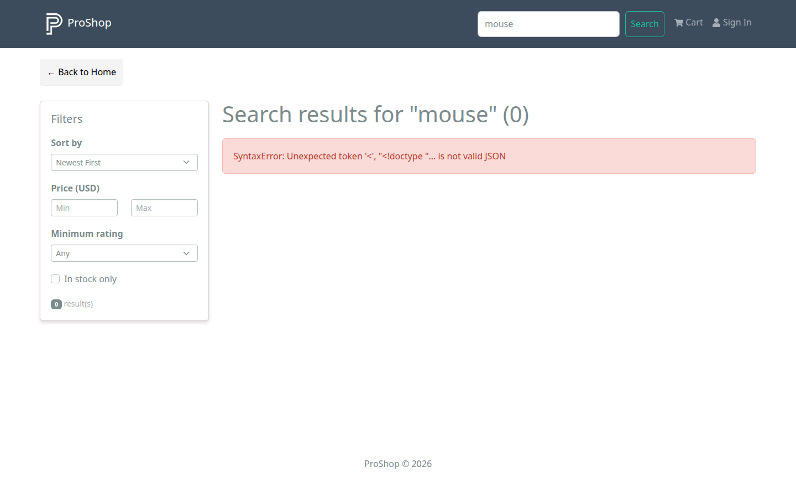
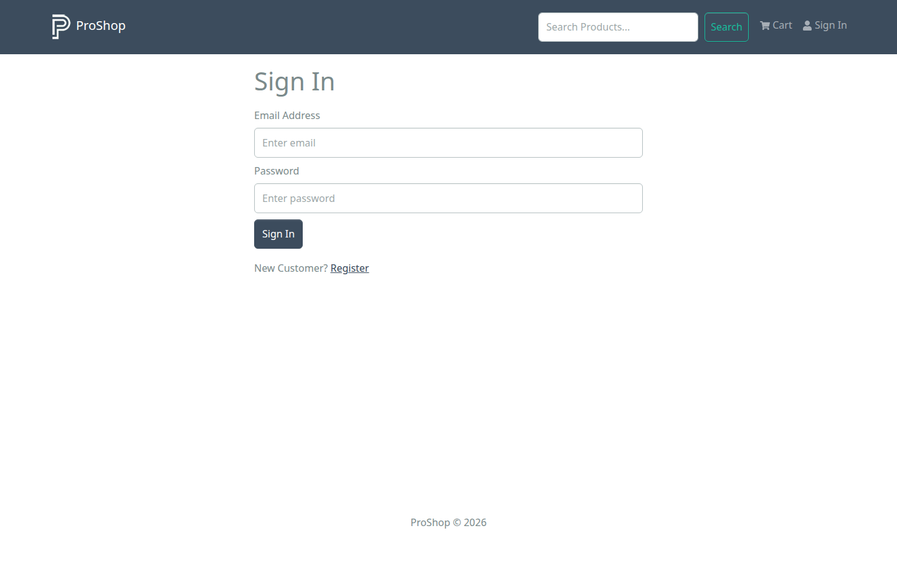
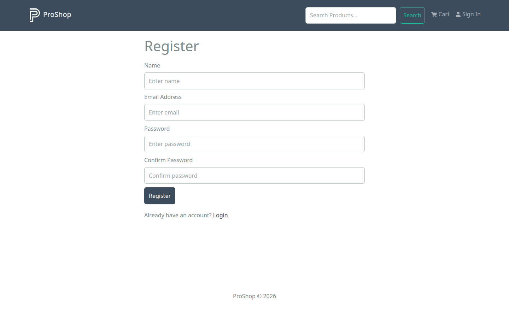
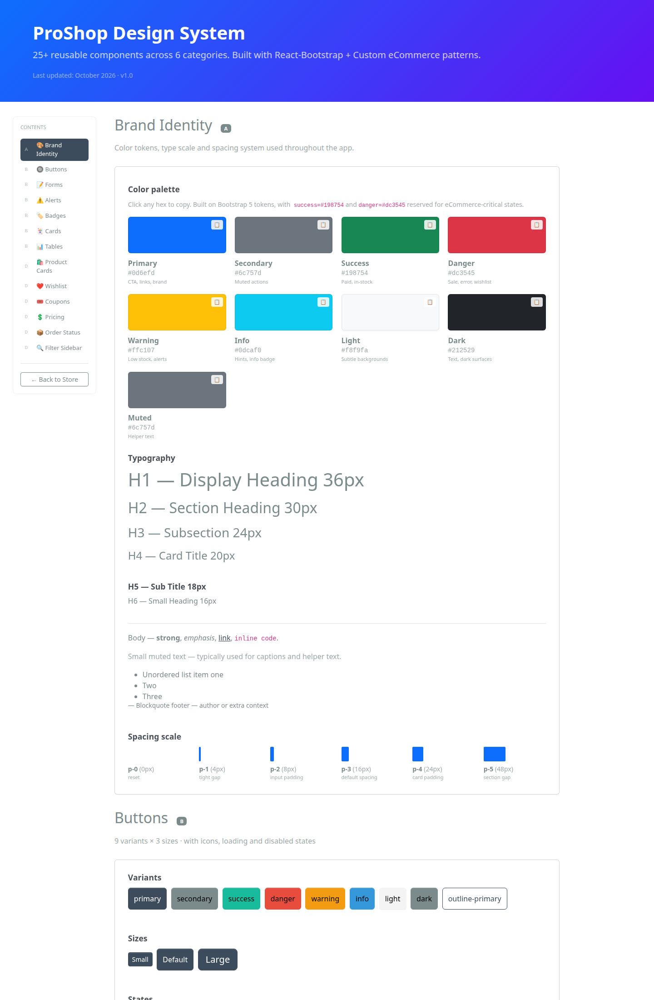
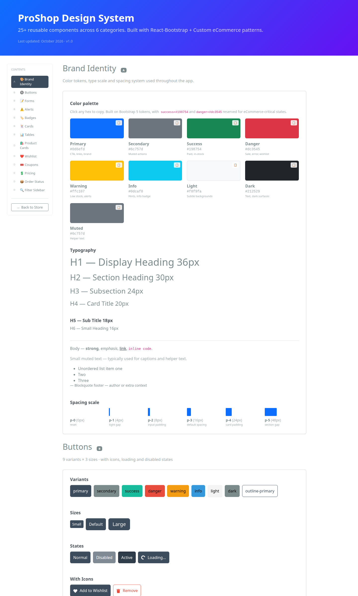
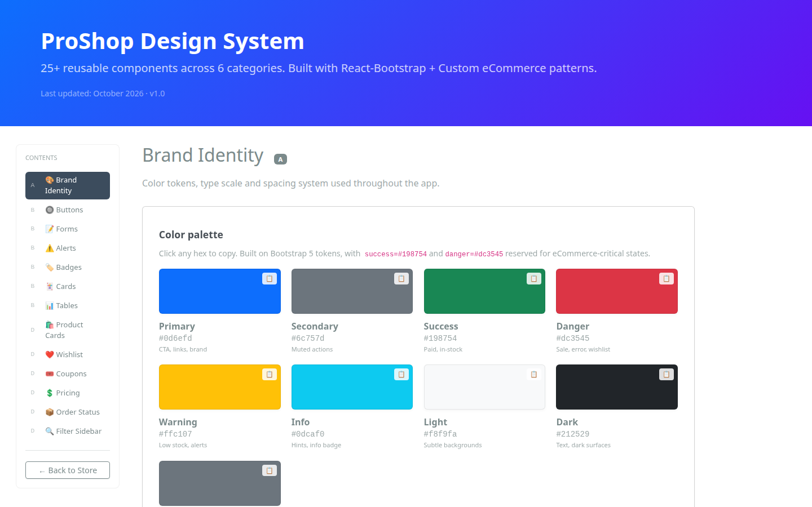

# ProShop eCommerce Platform (v2)

> A full-featured eCommerce platform built with the MERN stack (MongoDB, Express, React, Node.js) & Redux Toolkit.

<p align="center">
  
  
</p>

<p align="center">
  
  
</p>

<p align="center">
  
  
</p>

> **Above:** Home page · Design System Showcase · Filter & Sort · Product detail · Search · Login.
> See [Screenshots section](#-screenshots) below for the full set.

A complete eCommerce application featuring a shopping cart, product reviews, admin panel, and integrated PayPal & credit/debit card payments — plus a **Wishlist**, **coupon system**, **advanced filter+sort**, and a full **Design System Showcase** page.

### 🌟 Highlights

- ⭐ **Wishlist** with heart toggle, dedicated page, header badge
- 🎟️ **Discount Coupons** with server-side validation (per-user limits, max-discount cap, expiry)
- 🔍 **Advanced Filter & Sort** by category, brand, price, rating, in-stock
- 🎨 **Design System** showcase at `/design-system` (25+ components)
- 💳 PayPal + credit/debit card checkout

<!-- toc -->

- [🌟 Highlights](#-highlights)
- [📸 Screenshots](#-screenshots)
- [Features](#features)
- [Tech Stack](#tech-stack)
- [API Endpoints](#api-endpoints-newly-added)
- [Database Schema](#database-schema-new-collections)
- [Coupon Logic](#coupon-logic-server-side)
- [Filter & Sort](#filter--sort-api)
- [Usage](#usage)
  - [Env Variables](#env-variables)
  - [Install Dependencies](#install-dependencies)
  - [Run](#run)
- [Build & Deploy](#build--deploy)
  - [Seed Database](#seed-database)
- [License](#license)

<!-- tocstop -->

## Features

### 🛍️ Storefront
- Full featured shopping cart (multi-item, qty update, persistence)
- Product reviews and ratings (1-5 with comments)
- Top products carousel on home page
- Product pagination
- Product keyword search via URL (`/search/:keyword`)
- User profile with orders, name + email editable, password change

### 🔍 Advanced Filter & Sort (NEW in v2)
- Sort by: Newest, Price ↑/↓, Top Rated, Top Sellers, Name A→Z
- Filter by: Category (radio), Brand (multi-select), Price min/max,
  Minimum rating (1-4★+), In-stock only
- **URL-driven state** — shareable / refresh-safe / browser-back friendly
- Backend returns `facets` (available categories + brands) and `appliedFilters`
- Empty-state UI with "Clear filters" CTA
- See live at `/` (sidebar on the left)

### ⭐ Wishlist (NEW in v2)
- Heart icon on every Product card + detail page
- Dedicated `/wishlist` page with grid view + "move to cart" / "remove"
- Header badge counter (auto-refreshed)
- Optimistic UI + idempotent add (no duplicates)

### 🎟️ Discount Coupons (NEW in v2)
- Percentage or fixed-amount discounts
- Min order amount, max discount cap, total usage limit, per-user limit
- Date windows (start/end) + active/inactive flag
- Server-side validation (never trust client discount value)
- Coupon snapshot saved on every Order for auditability
- Full admin CRUD at `/admin/couponlist`
- Sample codes seeded: `WELCOME10` (10% off, min $50), `SAVE20` (20% off,
  capped $50, min $200), `FLAT15` ($15 off, min $30), `EXPIRED50`
  (expired, for testing validation)

### 🎨 Design System Showcase (NEW in v2)
- Public route at `/design-system` (no login required)
- 25+ components across Brand, Core, eCommerce sections
- Sticky TOC sidebar with active-section tracking
- Click-to-copy code snippets
- Reuses real components (Product, WishlistButton, FilterSidebar)
  → always in sync with the actual app

### 👨‍💼 Admin Panel
- Admin product list, edit, create, delete
- Admin user list, edit (toggle admin role), delete
- Admin order list, mark order as delivered
- Admin coupon list, create, edit, delete (full CRUD)

### 💳 Checkout
- Multi-step checkout: Shipping → Payment Method → Place Order
- PayPal + credit card integration (`@paypal/react-paypal-js`)
- Order history with status pills

### 🛠️ Engineering
- Database seeder (products, users, coupons)
- 19 backend tests via Jest + supertest
- JWT auth + cookie session
- Multer file uploads
- MongoDB ObjectId validation middleware
- Centralized error handler
- Code split per route (lazy-loading ready)


## Tech Stack

**Frontend:**
- React 18
- Redux Toolkit
- React Router v6
- Bootstrap 5

**Backend:**
- Node.js / Express
- MongoDB with Mongoose
- JWT Authentication
- Multer (file uploads)

## Usage

- Create a MongoDB database and obtain your `MongoDB URI` - [MongoDB Atlas](https://www.mongodb.com/cloud/atlas/register)
- Create a PayPal account and obtain your `Client ID` - [PayPal Developer](https://developer.paypal.com/)

### Env Variables

Rename the `.env.example` file to `.env` and add the following

```
NODE_ENV = development
PORT = 5000
MONGO_URI = your mongodb uri
JWT_SECRET = 'abc123'
PAYPAL_CLIENT_ID = your paypal client id
PAGINATION_LIMIT = 8
```

Change the JWT_SECRET and PAGINATION_LIMIT to what you want

### Install Dependencies

```bash
pnpm install
cd frontend
pnpm install
```

### Run

```bash
# Run frontend (:3000) & backend (:5000)
pnpm run dev

# Run backend only
pnpm run server

# Run frontend only
cd frontend
pnpm run dev
```

## Build & Deploy

```bash
# Create frontend prod build
cd frontend
pnpm run build
```

### Seed Database

You can use the following commands to seed the database with sample users and products

```bash
# Import data
pnpm run data:import

# Destroy data
pnpm run data:destroy
```

Sample user logins:
```
admin@email.com (Admin) - 123456
john@email.com (Customer) - 123456
jane@email.com (Customer) - 123456
```


## 📸 Screenshots

Full app visual gallery:

### Storefront

| Page | Screenshot |
|---|---|
| **Home (Carousel + Latest)** |  |
| **Filter & Sort Sidebar** |  |
| **Search results** (`/search/:keyword`) |  |
| **Product detail (with wishlist)** |  |
| **Login** |  |
| **Register** |  |

### Design System Showcase (`/design-system`)

A live UI kit documenting every component the app uses:

| View | Screenshot |
|---|---|
| **Top — Brand & Buttons** |  |
| **Cards & Tables section** |  |
| **eCommerce patterns (Product cards + coupons)** |  |
| **Above-the-fold view** |  |

> 💡 The Design System route (`/design-system`) is **public** — open it before
> reviewing the source code to see all patterns the team uses.

## API Endpoints (Newly added)

### Wishlist
| Method | Endpoint | Description | Access |
|---|---|---|---|
| GET    | `/api/users/wishlist`             | Get user's wishlist (populated) | Private |
| POST   | `/api/users/wishlist/:productId`  | Add a product (idempotent)     | Private |
| DELETE | `/api/users/wishlist/:productId`  | Remove a product               | Private |
| DELETE | `/api/users/wishlist`             | Clear wishlist                 | Private |

### Coupons
| Method | Endpoint | Description | Access |
|---|---|---|---|
| POST   | `/api/coupons/validate` | Validate code + compute discount (server-side) | Private |
| GET    | `/api/coupons`        | List all coupons                              | Admin |
| GET    | `/api/coupons/:id`    | Get single coupon                             | Admin |
| POST   | `/api/coupons`        | Create new coupon                             | Admin |
| PUT    | `/api/coupons/:id`    | Update a coupon                               | Admin |
| DELETE | `/api/coupons/:id`    | Delete a coupon                               | Admin |

### Database Schema (new collections)
```js
// User (added)
wishlist: [{ type: ObjectId, ref: 'Product' }]

// Coupon
{
  code: { type: String, required, unique, uppercase },
  description: String,
  type: { enum: ['percentage', 'fixed'] },
  value: Number,
  minOrderAmount: Number,
  maxDiscount: Number,
  usageLimit: Number,
  usageCount: Number,
  perUserLimit: Number,
  startDate: Date,
  expiresAt: Date,
  isActive: Boolean,
  applicableCategories: [String],
  applicableProducts: [ObjectId],
}

// Order (added)
discountPrice: Number,
coupon: { code, type, value, discount }  // snapshot
```

## Coupon Logic (server-side)

The discount is **always computed on the backend** — the client only sends
the coupon code. This prevents price tampering.

```
1. User submits couponCode at checkout (POST /api/orders)
2. Server looks up coupon, checks isAvailable() (active, in window, under limit)
3. Server checks per-user usage against Order history
4. Server computes: percentage(value, subtotal) capped by maxDiscount,
   or fixed value, never exceeding subtotal
5. Order stored with discountPrice + coupon snapshot
6. Atomic usageCount++  (avoids race conditions)
```

## Filter & Sort API

`GET /api/products` accepts the following query params (all optional):

| Param        | Type   | Example              | Description |
|--------------|--------|----------------------|-------------|
| `keyword`    | string | `mouse`              | Regex match on product name (case-insensitive) |
| `category`   | string | `Electronics`        | Single category radio |
| `brand`      | string | `Apple,Sony`         | Multi-select (comma-separated) |
| `priceMin`   | number | `50`                 | Minimum price (≥) |
| `priceMax`   | number | `500`                | Maximum price (≤) |
| `minRating`  | number | `4`                  | Minimum rating (≥) |
| `inStock`    | string | `true`               | Filter out `countInStock=0` |
| `sort`       | string | `price_asc`          | One of: `newest` (default), `price_asc`, `price_desc`, `rating`, `top_sellers`, `name` |
| `pageNumber` | number | `2`                  | 1-based pagination |

Response shape:
```json
{
  "products": [...],
  "page": 1,
  "pages": 1,
  "total": 6,
  "facets": {
    "categories": ["Electronics"],
    "brands": ["Amazon", "Apple", "Cannon", "Logitech", "Sony"]
  },
  "appliedFilters": { "keyword": "", "category": "", "brand": "", ... }
}
```

Frontend passes these params through `useSearchParams` — meaning the URL
becomes the source of truth, so filter state is shareable and refresh-safe.

### Example URLs (frontend)

```
/                                           # all products, newest first
/?sort=price_asc                            # cheapest first
/?category=Electronics                      # one category
/?brand=Apple,Sony&sort=rating              # two brands, top-rated first
/?priceMin=100&priceMax=500&inStock=true    # range + in-stock
/search/mouse                               # keyword "mouse"
```

## 🚀 Deployment

This project is **deploy-ready** with config files for the most common free tier stack.

| Service | What | File |
|---|---|---|
| Vercel | Frontend (React SPA) | `vercel.json` |
| Render | Backend (Node + Express API) | `render.yaml` |
| MongoDB Atlas | Database (M0 free) | Manual setup |
| GitHub Actions | CI (lint + test + build) | `.github/workflows/ci.yml` |

Quick deploy (~36 min of user effort):

1. **Push to GitHub**
   ```bash
   git remote add origin https://github.com/<you>/proshop-v2.git
   git push -u origin main
   ```
2. **Create MongoDB Atlas M0 cluster** → get SRV connection string
3. **Deploy backend on Render**
   - Blueprint → point to repo
   - Set env vars: `MONGO_URI`, `JWT_SECRET` (new), PayPal keys
   - Run `node seeder.js` via Shell tab to seed
4. **Deploy frontend on Vercel**
   - Add New Project → import repo
   - Root: `frontend` · Build: `npm run build` · Output: `build`
   - Set `REACT_APP_API_URL` = your Render URL
5. **Smoke test** the deployed URLs

> 📖 Full step-by-step guide with troubleshooting → [`docs/DEPLOYMENT_PROPOSAL.md`](./docs/DEPLOYMENT_PROPOSAL.md)

### Badges


> Replace the badges above with live URL badges after deploying.


MIT
