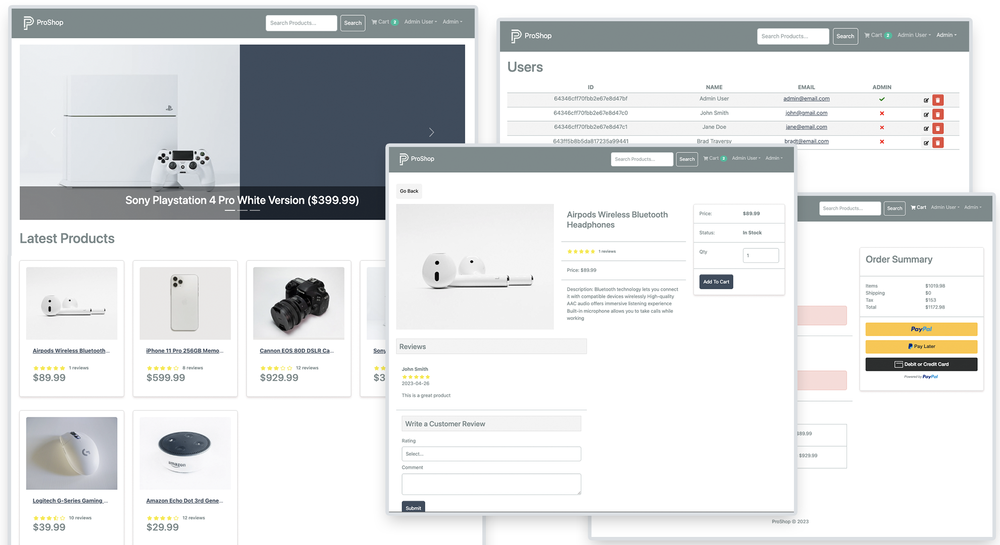

# ProShop eCommerce Platform (v2)

> A full-featured eCommerce platform built with the MERN stack (MongoDB, Express, React, Node.js) & Redux Toolkit.



This is a complete eCommerce application featuring a shopping cart, product reviews, admin panel, and integrated PayPal & credit/debit card payments.

<!-- toc -->

- [Features](#features)
- [Tech Stack](#tech-stack)
- [Usage](#usage)
  - [Env Variables](#env-variables)
  - [Install Dependencies](#install-dependencies)
  - [Run](#run)
- [Build & Deploy](#build--deploy)
  - [Seed Database](#seed-database)
- [License](#license)

<!-- tocstop -->

## Features

- Full featured shopping cart
- Product reviews and ratings
- Top products carousel
- Product pagination
- Product search feature
- User profile with orders
- Admin product management
- Admin user management
- Admin Order details page
- Mark orders as delivered option
- Checkout process (shipping, payment method, etc)
- PayPal / credit card integration
- Database seeder (products & users)

### ⭐ Newly added

- **Wishlist** — heart toggle on every product card, dedicated wishlist page with
  "move to cart" and "clear all" actions, header badge with item count
  (Backend: `GET/POST/DELETE /api/users/wishlist[/:productId]`)
- **Discount Coupons** — server-side validated coupons at checkout:
  - Percentage or fixed discounts
  - Min order amount, max discount cap, total + per-user usage limits
  - Date windows (start/end) and active flag
  - Admin CRUD at `/admin/couponlist`
  - Sample codes after seeding: `WELCOME10` (10% off, min $50),
    `SAVE20` (20% off capped $50, min $200), `FLAT15` ($15 off, min $30),
    `EXPIRED50` (intentionally expired, used to test validation)


## Tech Stack

**Frontend:**
- React 18
- Redux Toolkit
- React Router v6
- Bootstrap 5

**Backend:**
- Node.js / Express
- MongoDB with Mongoose
- JWT Authentication
- Multer (file uploads)

## Usage

- Create a MongoDB database and obtain your `MongoDB URI` - [MongoDB Atlas](https://www.mongodb.com/cloud/atlas/register)
- Create a PayPal account and obtain your `Client ID` - [PayPal Developer](https://developer.paypal.com/)

### Env Variables

Rename the `.env.example` file to `.env` and add the following

```
NODE_ENV = development
PORT = 5000
MONGO_URI = your mongodb uri
JWT_SECRET = 'abc123'
PAYPAL_CLIENT_ID = your paypal client id
PAGINATION_LIMIT = 8
```

Change the JWT_SECRET and PAGINATION_LIMIT to what you want

### Install Dependencies

```bash
pnpm install
cd frontend
pnpm install
```

### Run

```bash
# Run frontend (:3000) & backend (:5000)
pnpm run dev

# Run backend only
pnpm run server

# Run frontend only
cd frontend
pnpm run dev
```

## Build & Deploy

```bash
# Create frontend prod build
cd frontend
pnpm run build
```

### Seed Database

You can use the following commands to seed the database with sample users and products

```bash
# Import data
pnpm run data:import

# Destroy data
pnpm run data:destroy
```

Sample user logins:
```
admin@email.com (Admin) - 123456
john@email.com (Customer) - 123456
jane@email.com (Customer) - 123456
```


## API Endpoints (Newly added)

### Wishlist
| Method | Endpoint | Description | Access |
|---|---|---|---|
| GET    | `/api/users/wishlist`             | Get user's wishlist (populated) | Private |
| POST   | `/api/users/wishlist/:productId`  | Add a product (idempotent)     | Private |
| DELETE | `/api/users/wishlist/:productId`  | Remove a product               | Private |
| DELETE | `/api/users/wishlist`             | Clear wishlist                 | Private |

### Coupons
| Method | Endpoint | Description | Access |
|---|---|---|---|
| POST   | `/api/coupons/validate` | Validate code + compute discount (server-side) | Private |
| GET    | `/api/coupons`        | List all coupons                              | Admin |
| GET    | `/api/coupons/:id`    | Get single coupon                             | Admin |
| POST   | `/api/coupons`        | Create new coupon                             | Admin |
| PUT    | `/api/coupons/:id`    | Update a coupon                               | Admin |
| DELETE | `/api/coupons/:id`    | Delete a coupon                               | Admin |

### Database Schema (new collections)
```js
// User (added)
wishlist: [{ type: ObjectId, ref: 'Product' }]

// Coupon
{
  code: { type: String, required, unique, uppercase },
  description: String,
  type: { enum: ['percentage', 'fixed'] },
  value: Number,
  minOrderAmount: Number,
  maxDiscount: Number,
  usageLimit: Number,
  usageCount: Number,
  perUserLimit: Number,
  startDate: Date,
  expiresAt: Date,
  isActive: Boolean,
  applicableCategories: [String],
  applicableProducts: [ObjectId],
}

// Order (added)
discountPrice: Number,
coupon: { code, type, value, discount }  // snapshot
```

## Coupon Logic (server-side)

The discount is **always computed on the backend** — the client only sends
the coupon code. This prevents price tampering.

```
1. User submits couponCode at checkout (POST /api/orders)
2. Server looks up coupon, checks isAvailable() (active, in window, under limit)
3. Server checks per-user usage against Order history
4. Server computes: percentage(value, subtotal) capped by maxDiscount,
   or fixed value, never exceeding subtotal
5. Order stored with discountPrice + coupon snapshot
6. Atomic usageCount++  (avoids race conditions)
```

## License

MIT
